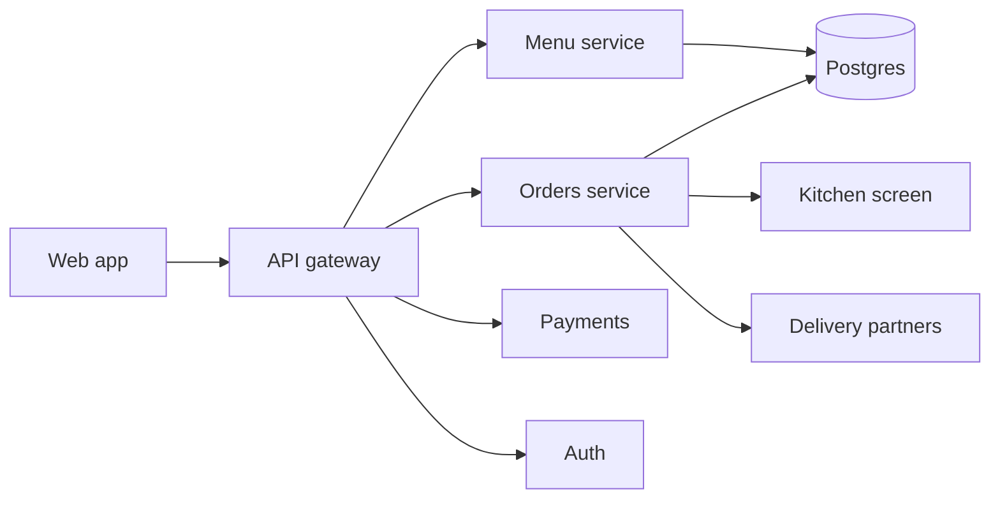

# System overview

Four services and one database run the restaurant. The [customer web app](../../forkflame-web/docs/index.md)
talks only to the API gateway; everything behind it is private.

## Request path of an order

1. The gateway authenticates (or accepts a guest) and rate-limits per the
   [rate limits](../policies/rate-limits.md).
2. The orders service reserves the dishes, computes the total and creates the order
   in state `received`.
3. Payments captures the charge; only then does the order move to `firing` on the
   kitchen screen.
4. When the courier picks up, the orders service emits a webhook (see
   [outbound webhooks](../services/webhooks.md)).

Full service list with ports: [service map](./service-map.md).
